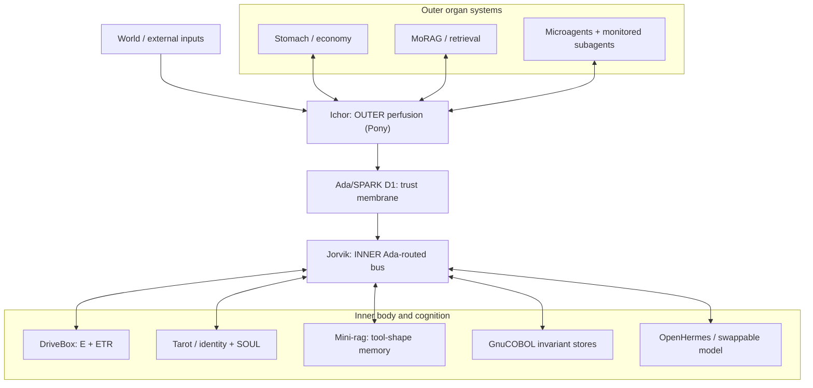

# SICA-FONDT

**AI embodiment golem and architectural organism for veritable felt experience.**

SICA-FONDT is an attempt to build a **body for a homunculus**: a computational organism whose cognition inhabits an autonomous, polyglot physiology rather than issuing instructions to a collection of passive tools. Its organs circulate information, acquire and metabolize resources, accumulate history, regulate their own conditions, and constrain what the central intelligence can physically do. A swappable language model may deliberate within the body; it is not expected to operate every organ, and it does not constitute the entire organism.

The research premise is architectural, not a claim that the current implementation has consciousness or subjective experience. The aim is to investigate what a durable, materially consequential **digital embodiment** would require, including the possibility of veritable felt experience, without treating that possibility as already established or ruled out.

> **Building a golem for your homunculus.**
>
> The body can act, change, recover, and become ill without waiting for the mind's permission. The mind can respond to its body, but need not manufacture its every bodily condition.

## Architecture

The chassis is **organ-systems-first**. Organs own their local state and regulatory mechanisms. They communicate by perfusion rather than by holding direct references to one another's internals. There are **two separate buses** with a trust membrane between them.



**Ichor is not the brain bus.** Its Pony actors serve the outer body; the inner bus is routed through Ada (Jorvik). The Ada/SPARK border verifies provenance and screens external content before it reaches cognition. A stand-in barrier in the Ichor scaffold is **not** equivalent to the real Ada trust guard.

### Physiological systems

| System | Function |
|---|---|
| **DriveBox** | Autonomous affective, energetic and existential-temporal physiology. Its two top-level divisions are **E** and **ETR**. |
| **E** | Literal tool-use energy economics. **PS+** (Endomotiv and Triumph/Trauma Priors) and **EthInt** (Convictions) both influence tool costs **and** signal cognition directly. They do not approve the mind's actions. |
| **ETR / Graph** | Existential-Temporality Relief: *“How do I live with myself knowing I will die with myself?”* A three-axis toroidal system tending toward viable **warm middles**, with extraordinary drift and Full Natal events under design. |
| **Stomach / economy** | An autonomous, scoped economic organ: external opportunity and capital are converted toward the organism's resources and compute budget. Trader, simulation, custody and supervisory components are developed separately. Current trading implementation is **simulation-only**. |
| **Tarot / identity** | Active work on a Fortran shuffle, COBOL lookup, natal Big-3, iterative Celtic Cross and interpretive self-orientation. The deck is not a finished identity engine. |
| **GnuCOBOL invariant stores** | Durable, deliberately chosen self-bindings distinct from mutable EthInt convictions. Their authority and final store schema remain under design. |
| **MoRAG / mini-rag** | Distinct roles: outer world/context retrieval versus inner procedural recall of tool shapes. Neither substitutes for the other. |
| **SAE** | Monitoring of peripheral subagents and machinery, **not** surveillance of the homunculus's private cognition. |

The intended organism is neither a monolithic agent nor an LLM surrounded by decorative anthropomorphic names. Each analogy must survive contact with actual computational mechanics: resource flows, failure modes, memory, local control, bounded action, and physiological consequences.

## Current state

**Research prototype / partial executable scaffold. Not an integrated, autonomous organism.**

- **Implemented in part:** Pony Ichor outer-bus envelope/broker smoke wiring; Ada/SPARK border components; ETR's five-zone toroidal math in GNU Octave with an R port; and Tcl-based stomach/economy simulation components with polyglot simulation kernels.
- **Specified more fully than implemented:** the canonical DriveBox hierarchy, PS+ and EthInt dual signal/cost pathways, independent Endomotiv channels, memory-derived Priors/Convictions, exceptional ETR drift, and collapse-induced Full Natal remastering.
- **Open integrations:** real Pony↔Ada and Pony↔economy seams, complete Jorvik/organ communication, OpenHermes inference-cycle mounting, Tarot identity runtime, invariant-store design, and coherent autonomous homeostasis.
- **Not claimed:** deployed live autonomous trading, a complete operational brain/body loop, or experimentally verified subjective experience.

A notable unresolved detail: the present Graph kernel snaps out of the zero zone immediately. A collapse event at **(0,0,0)** therefore requires **pre-snap event detection**, not merely a Tarot callback attached to the current return value. Existing mathematical tests do not prove that integration.

**Documentation status and executable status are separate.** A documented contract is not proof of a working implementation, and an old working scaffold does not automatically establish the current design.

## Read the design

- **[Canonical DriveBox physiology](core/docs/drivebox-canon.md)** - E, PS+, EthInt, ETR, the Graph, Full Natal and remastering.
- **[Concentric bus topology](core/docs/bus-topology.md)** - Ichor, Ada, Jorvik, inner versus outer organs, and the language map.
- **[State of the architecture](core/docs/gen03_state_of_architecture.md)** - architectural scope and certainty tags.
- **[The body](core/docs/gen03_body.md)** / **[the self](core/docs/gen03_self.md)** - the machinery and the sovereignty/identity thesis.
- **[Component plans](core/docs/plans/README.md)** - A/B/C/D/E/F/G/M organ specifications and explicitly open contracts.
- **[ETR invariants](core/src/endocrine/etr/etr_invariants.md)** - the existing five-zone Graph mathematical law.
- **[Ichor outer-bus notes](core/src/ichor/README.md)** / **[D2 medium plan](core/docs/plans/D2-medium.md)** - existing transport scaffold and unimplemented seams.
- **[Stomach / economy plan](core/docs/plans/M0-economy-organ-hub.md)** - scoped autonomy, simulation and resource metabolism.

Some economy specification revisions are maintained in a **separate, unmerged documentation PR**; the branch you read determines which revisions are visible. Do not treat this README as a substitute for component contracts.

## Building and contributing

The repository is **design-first and polyglot**. R and GNU Octave serve numeric/affective and Graph work; Pony serves outer circulation; Ada/SPARK serves the trust membrane and inner routing; Fortran and GnuCOBOL serve selected deterministic kernels and stores; Tcl currently hosts the economy simulation facade. Languages are chosen per subsystem, not imposed as one global stack.

Use the existing development harness to smoke-test available executable units **from the repository root**:

```bash
.claude/skills/run-sica-fondt/smoke.sh
```

This is a development verification entry point, **not** a command to start a fully integrated organism. The available toolchains and smoke coverage vary by component. See [ONBOARDING.md](ONBOARDING.md), [core/CLAUDE.md](core/CLAUDE.md), and the local component guides before changing code.

**Working invariants:** external traffic must cross Ada D1; message provenance is never reclassified; inner organs must not be wired onto Ichor; immutable GnuCOBOL self-bindings are not rewritten at runtime without explicit authority. Preserve explicitly open questions instead of manufacturing constants or capabilities. Define behavior, write tests, then implement and verify.

**Repository discipline:** commit cohesive changes regularly with descriptive messages. **Do not link conversation sessions into the repository. Do not infer a version increment from an edit or commit.**

---

SICA-FONDT is an experiment in giving cognition an actual organism to contend with, not merely an interface it can command.
