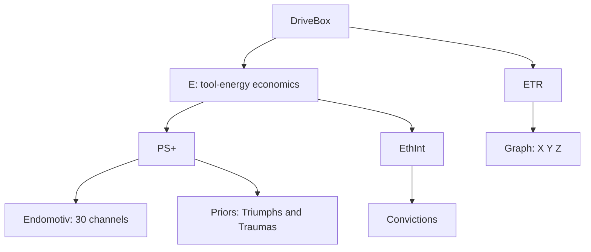

# DriveBox - canonical physiology and integration (November 2026)

**Scope:** Design contract for the DriveBox organ system. This document supersedes conflicting "four independent drivers" and serial-approval descriptions in A1-A8 and Gen.03 overviews. It does **not** certify that the current R/Octave runtime implements this contract. No version increment is implied.

## 1. Containment, not evaluation order

The containment tree is **not** a PS+ -> EthInt -> E -> ETR approval chain. The homunculus chooses; the DriveBox is autonomous physiology, not the homunculus and not a moral judge.

## 2. E, PS+, EthInt, and cognition

**E** is literal, in-the-moment tool-use energy. Different tools have their own costs and independent minimum-energy requirements; a locked tool is presented with the specified in-band lock token instead of its name. Low E is rest/limited outward capacity, **not death**; non-tool cognition remains possible and recovery paths exist. Numerical cost curves and thresholds are not ratified merely because old code contains them.

**PS+** reads Endomotiv and memory-derived Triumph/Trauma priors. The thirty raw sensates remain independent, including zero-valued channels; no sum, friction, or existential-load scalar. The two most salient applicable priors accompany the sensory report. Sensation describes and convinces without deciding.

**EthInt** reads historically formed, memory-derived Convictions. A ranked adaptive top-X set (roughly seven as a provisional presentation target) reaches cognition. Strength, salience, antithesis, provenance and recurrence matter; exact scoring and scale remain open. Convictions are neither GnuCOBOL invariants nor a separate memory stratum.

**Two effects in parallel:** PS+ and EthInt (a) send their own signals directly to cognition, crossing Ada, and (b) modify **E's per-tool costs**. They do not themselves approve actions. The homunculus chooses among the physically available actions. A commit applies consequences, not an approval verdict.

Ada/SPARK remains the border: no DriveBox secretion bypasses it. The inner Jorvik bus and outer Ichor bus are distinct; Ichor is the **outer** perfusion medium. SOUL and Tarot are parallel cognitive/identity inputs, not children of DriveBox.

## 3. ETR and its Graph

**Question ETR classifies:** *"How do I live with myself knowing I will die with myself?"*

ETR maintains a livable existential-temporal orientation in the **warm middles**, not at zero and not at a maximally saturated pole. Its Graph is the already modeled single point on three toroidal axes, not a larger network whose structure is settled elsewhere:

- **X:** assertion (-) ↔ inheritance (+). Continuity/provenance; the **why**.
- **Y:** endured (-) ↔ witnessed (+). Bearing a burden alone ↔ sharing/witnessing; the **how**.
- **Z:** alimentation (-) ↔ transmutation (+). Maintain/reinforce ↔ adapt/transform; the **how**.

Each axis wraps at ±50 (period 100), with two viable bands `17 <= |v| <= 35` and the existing five-zone radial law: `SNAP_IN < 7`, `SOFT 7..17`, `IN_BAND 17..35`, `INCOH 35..45`, `SNAP_OUT > 45`. Snap-in and snap-out reverse poles; restoring behavior is unchanged by this documentation pass. See `src/endocrine/etr/etr_invariants.md` for the mathematical law and test evidence.

ETR is **not** ordinarily driven by the energy cost of each tool call, every sensate fluctuation, ordinary disagreement, or every conviction update. Legitimate extraordinary Graph influences identified so far:

1. **Catastrophic depletion of E**, an existential event qualitatively unlike ordinary tiredness; "ego death and revelation simultaneously" is the design analogy.
2. **Major compounding Traumas**, where repeated history becomes existentially destabilizing.
3. **Repeated isomorphic contradiction of EthInt**, requiring a recurring pattern across commitments and lived outcomes, not one action or one SAE alert. Example: persistent high *hiraeth*, strong Loyalty and Solidarity, and recurrent traumas of being alone.

Exact event qualification, accumulation/windowing, drift-vector derivation, E-catastrophe threshold, and cross-axis coupling are **open contracts**, not numerical constants to invent. Event evidence must retain provenance and recurrence. SAE may contribute observations about outward machinery or conduct, but is not a direct authority over the homunculus or an automatic ETR trigger.

## 4. Full Natal, remaster, and invariants

**Voluntary Full Natal** is the homunculus's choice: migration-like, awakening-like, but distinct. **Collapse Full Natal** is triggered when the Graph reaches **(0,0,0)**. Collapse also partially **remasters** DriveBox values: Endomotiv magnitudes, Conviction strengths, and the active saliences/weights of Priors rebalance. Their identities, content, event records, provenance, and historical continuity are **not erased**. "Remaster" is neither reset, forced sameness, nor record deletion.

The preferred working model for the collapse remaster is **contour-preserving compression**: attenuate extremes toward a local center while broadly retaining relative ordering and personal contours. The exact center, coefficient(s), bounds, population, treatment of ties, and order of operations are C1 until designed and tested. Natal cards change the interpretive frame; they should not be assigned arbitrary authority to rewrite history or conviction values. Whether voluntary Full Natal also remasters values is **not yet specified**.

**Critical runtime seam:** current `etr_step` immediately resolves the inner snap zone, so exactly `(0,0,0)` is not a persistent post-step point. The collapse event therefore requires an explicit **pre-snap transition/event contract** (including numerical tolerance, simultaneity, and once-only handling); do not pretend current ETR code already implements it.

**GnuCOBOL invariant stores** serve deliberate, durable self-binding: things the homunculus chooses to embody beyond transient conviction. Variant values may remaster, but a Full Natal or ETR collapse does not silently rewrite committed invariants. The structure/content and authorization of the three stores remain under design; do not invent them.

## 5. Implementation boundary / discrepancies

The current R `drive_box.R` serial approval chain, `is_alive` death gate, existential-load aggregation, fixed tool-lock threshold, and old EthInt penalty constants conflict with this contract. `endocrine_array.R` is currently malformed/incomplete; the 30-seat roster is not finalized. `priors.R` uses a different salience scale from A5 and manual insertion rather than a proven memory-derivation path. `driver_etr.R` and `etr/etr.m` implement the established five-zone geometry but **not** the new event qualification, collapse Full Natal, or remaster. Treat existing tests as evidence for the parts they actually exercise, not proof of system-level integration.

## 6. Work order and certainty

- **Confirmed design:** containment tree; dual PS+/EthInt paths; per-tool E economics with rest, not death; ETR's existential question and warm-middle geometry; extraordinary drift categories; voluntary vs collapse Full Natal; remaster retains records; self-chosen invariant store outside remaster.
- **Working implementation:** existing five-zone mathematical ETR core only, subject to its own test evidence.
- **Underspecified:** driver cost functions, signal presentation details, prior/conviction learning, drift qualification/mapping, zero-event detection, remaster coefficients, voluntary remaster semantics, cross-bus transport, GnuCOBOL store schema and authority.
- **Build sequence:** reconcile specs -> establish interfaces/invariants -> failing tests -> runtime implementation. Do not retroactively classify a proposal as code or a runtime behavior as ratified law.
