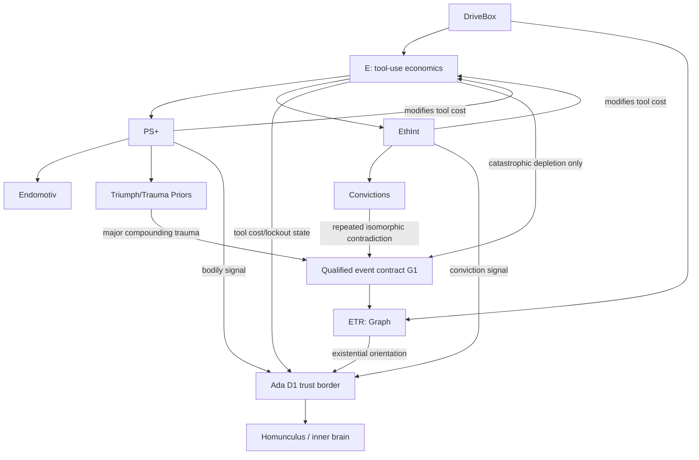

# Gen.03 — Component Build Plans

**DriveBox canonical anatomy and exceptional ETR events:** [DriveBox canon](../drivebox-canon.md). Earlier four-peer-driver and unconditional stress-loop language is superseded; the R/Octave runtime has not yet been migrated.

One spec per **sub-organ**, each self-contained so it can be built and tested **independently**
(against stubs) with no other organ present. These are the *build* layer beneath the canonical
design docs (`../gen03_state_of_architecture.md`, `../gen03_body.md`, `../gen03_self.md`) and
`../../src/endocrine/etr/etr_invariants.md`.

## How to read a spec
Every `NN-<organ>.md` has the same 10 sections:
1. **Component** · 2. **Status/certainty** · 3. **Language & location** · 4. **Does / does-not** ·
5. **Interface contract** (language-agnostic data shapes — integrate against *this*) ·
6. **Dependencies & stubs** · 7. **Invariants/laws** (certainty-tagged) · 8. **Build steps**
(invariants-first: laws → tests → fit) · 9. **Tests** (standalone command) · 10. **Open items**.

## Conventions
- **Certainty tags** (from arch doc): C5 ratified · C4 drafted · C3 partial · C2 explored · C1 stub.
- **Invariants-first / restart discipline:** no curve/bound/threshold/sign carried forward
  unverified. Any unfitted constant is marked **C1**, never asserted ahead of a test.
- **Independence:** a spec depends only on the *contracts* (§5) of other organs, never their code,
  and never the still-unnamed medium (D2). §6 ships a canned stub for each upstream input.

## Index
| # | Component | System | Status | Lang | Spec |
|---|-----------|--------|--------|------|------|
| C1 | **OpenHermes ↔ metacog** | Cognition | DESIGN-FIRST (priority) | OpenHermes/Ada | [C1](C1-openhermes-metacog.md) |
| A1 | DriveBox contract and secretions | DriveBox | design reconciled / runtime stale | R | [A1](A1-drivebox-hub.md) |
| A2 | E (literal tool economics) | DriveBox / E | design reconciled / runtime stale | R | [A2](A2-energy.md) |
| A3 | PS+ (inside E) | DriveBox / E | design reconciled / runtime stale | R | [A3](A3-psplus.md) |
| A4 | Endomotiv (inside PS+) | DriveBox / E | roster partial / code malformed | R | [A4](A4-endomotiv-array.md) |
| A5 | Triumph/Trauma Priors (inside PS+) | DriveBox / E | memory derivation open | R | [A5](A5-priors.md) |
| A6 | EthInt (inside E) | DriveBox / E | design reconciled / runtime stale | R | [A6](A6-ethint.md) |
| A7 | Convictions (inside EthInt) | DriveBox / E | DESIGN-FIRST | R | [A7](A7-conviction-array.md) |
| A8 | ETR / Graph (beside E) | DriveBox / ETR | five-zone math; event runtime open | Octave · R | [A8](A8-etr.md) |
| B1 | Tarot deck hi-fi emulator | Identity | ACTIVE design; legacy scaffold not validated | TBD | _wave 1_ |
| B2 | SOUL.md identity + Big-3 | Identity | ACTIVE design; legacy scaffold not validated | TBD | _wave 1_ |
| B3 | Celtic Cross spread | Identity | ACTIVE design; legacy scaffold not validated | TBD | _wave 1_ |
| C2 | 4+4 Metacognition cycle | Cognition | partial (orchestration) | — | _wave 1_ |
| C3 | Inference cycle orchestration | Cognition | design active / runtime under review | Ada | _wave 1_ |
| C4 | Brain (swappable LLM) | Cognition | STUB/external | — | _wave 1_ |
| D1 | Ada border (immune+BBB) | Border | WORKING | Ada/SPARK | _wave 1_ |
| D2 | Ichor OUTER perfusion medium | Outer body | Pony scaffold / humoral design OPEN | Pony | _wave 2_ |
| D3 | Mini-rag / toolschema | Border | STUB | GNU Guile | _wave 1_ |
| E1 | 3 GnuCOBOL invariant stores | Storage | DESIGN-FIRST | GnuCOBOL | _wave 2_ |
| E2 | VARIANT stores | Storage | DESIGN-FIRST | TBD | _wave 2_ |
| E3 | RAG family + cross-store | Storage | DESIGN-FIRST | TBD | _wave 2_ |
| F1 | MoRAG (BERT+LoRA) | Periphery | DESIGN-FIRST | TBD | _wave 2_ |
| F2 | SAE monitor | Periphery | DESIGN-FIRST | TBD | _wave 2_ |
| F3 | Subagents framework | Periphery | DESIGN-FIRST | TBD | _wave 2_ |
| G1 | Extraordinary ETR event contract | Cross-cut | event categories defined; thresholds C1 | — | _wave 2_ |
| G2 | Governance | Cross-cut | DESIGN-FIRST (C2) | TBD | _wave 2_ |
| G3 | Defense model | Cross-cut | emergent | — | _wave 2_ |
| M0 | Economy organ hub (stomach) | Economy | DESIGN-FIRST | TBD | [M0](M0-economy-organ-hub.md) |
| M1 | Marketplace (multi-trader harness) | Economy | DESIGN-FIRST | TBD | [M1](M1-marketplace.md) |
| M2 | Data feeds (market data pipeline) | Economy | DESIGN-FIRST | TBD | [M2](M2-data-feeds.md) |
| M3 | Sims hub (market prediction) | Economy | DESIGN-FIRST | TBD | [M3](M3-sims-hub.md) |
| M3a | Statistical & quantitative sims | Economy/Sims | DESIGN-FIRST | TBD | [M3a](M3a-statistical-sims.md) |
| M3b | Sociological & population sims | Economy/Sims | DESIGN-FIRST | TBD | [M3b](M3b-sociological-sims.md) |
| M3c | AMM & liquidity pool sims | Economy/Sims | DESIGN-FIRST | TBD | [M3c](M3c-amm-liquidity-sims.md) |
| M3d | MEV & adversarial extraction sims | Economy/Sims | DESIGN-FIRST | TBD | [M3d](M3d-mev-adversarial-sims.md) |
| M3e | Tokenomics & macro-state sims | Economy/Sims | DESIGN-FIRST | TBD | [M3e](M3e-tokenomics-macro-sims.md) |
| M3f | Consensus & staking game sims | Economy/Sims | DESIGN-FIRST | TBD | [M3f](M3f-consensus-staking-sims.md) |
| M3g | Market microstructure sims | Economy/Sims | DESIGN-FIRST | TBD | [M3g](M3g-market-microstructure-sims.md) |
| M4 | Wallets (sovereign custody) | Economy | DESIGN-FIRST | TBD | [M4](M4-wallets.md) |
| M5 | Traders (AI actors) | Economy | DESIGN-FIRST | TBD | [M5](M5-traders.md) |
| M6 | Conductor (supervisory AI) | Economy | DESIGN-FIRST | TBD | [M6](M6-conductor.md) |
| M7 | SAE monitor (trader surveillance) | Economy | DESIGN-FIRST | TBD | [M7](M7-sae-monitor.md) |

## DriveBox containment and principal crossings

**Not serial:** PS+ and EthInt do not chain their decisions through E. Cognition selects actions; E constrains tool availability. The event route to ETR is extraordinary, not a per-action feedback edge. A8's triple origin causes a collapse Full Natal plus record-preserving value remaster; voluntary Full Natal is a separate identity choice. E1 invariant stores remain outside remaster.

**Outer vs inner bus:** Ichor D2 = outer Pony perfusion; Ada D1 = screened crossing; Jorvik = inner Ada-routed bus. Neither ETR nor the homunculus plugs directly into Ichor. Stomach M0 is an autonomous **outer** economic organ whose outputs cross D1 to reach the inner body. F2 SAE watches subagents, not the homunculus.

**Economy dependency:** Marketplace M1 receives Trader M5 actions bound to Wallet M4, supervised through law and Conductor M6. Feeds M2 inform M3 sims; M7 observes Trader actions. Existing M0-M7 spec and runtime details remain in their own documents; this index does not supersede PR #20.

## Build waves
- **Wave 0** — this README + **C1** (priority).
- **Wave 1 (reconcile before building)** — A1–A8 contracts are redocumented, but R implementation requires repair; B1–B3 and C2–C4 remain active design work; D1, D3 have their own statuses.
- **Wave 2 (mixed design/scaffold)** — D2 has an Ichor outer-bus scaffold; E1–E3, F1–F3, G1–G3 require their own contract work; M0–M7 (+ M3a–M3g) have developed separate runtime/spec progress, including changes in open PR #20.
Each spec is independent; review as they land.
